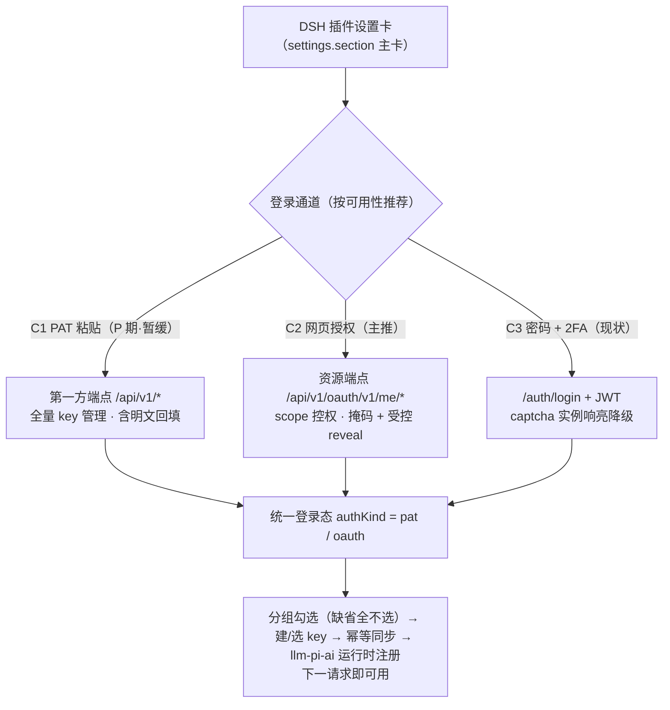
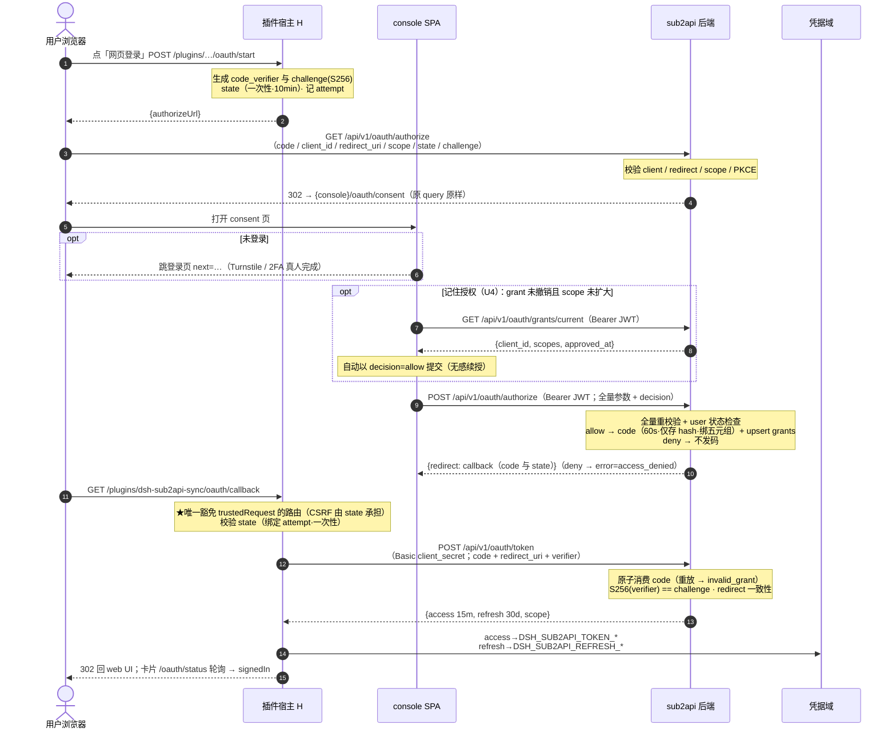
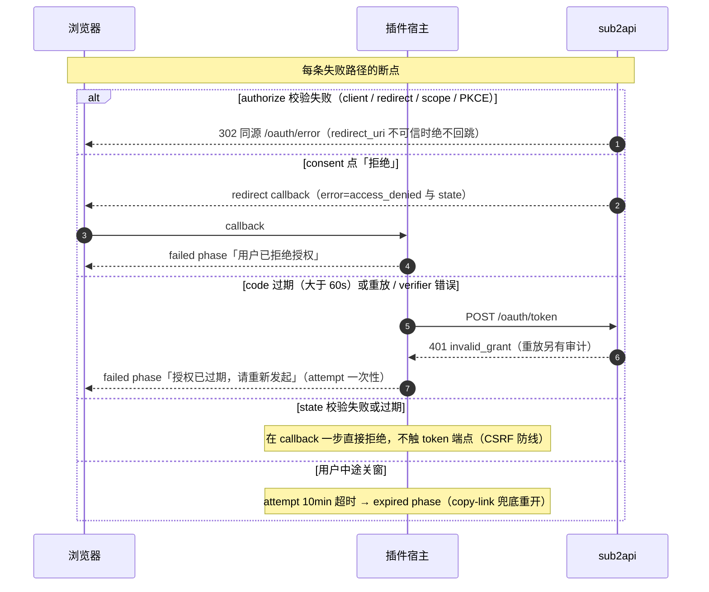
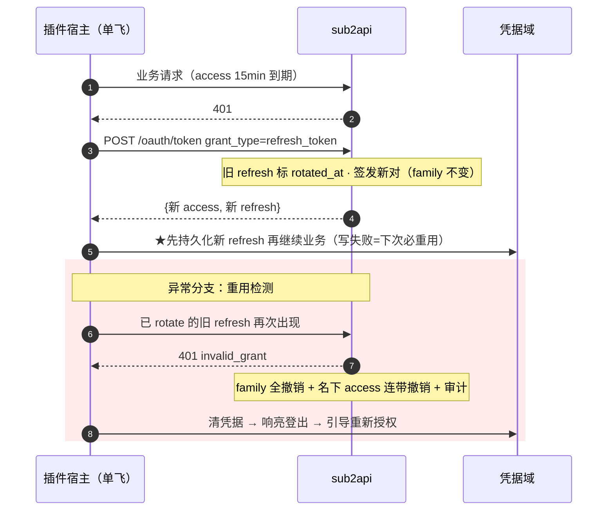
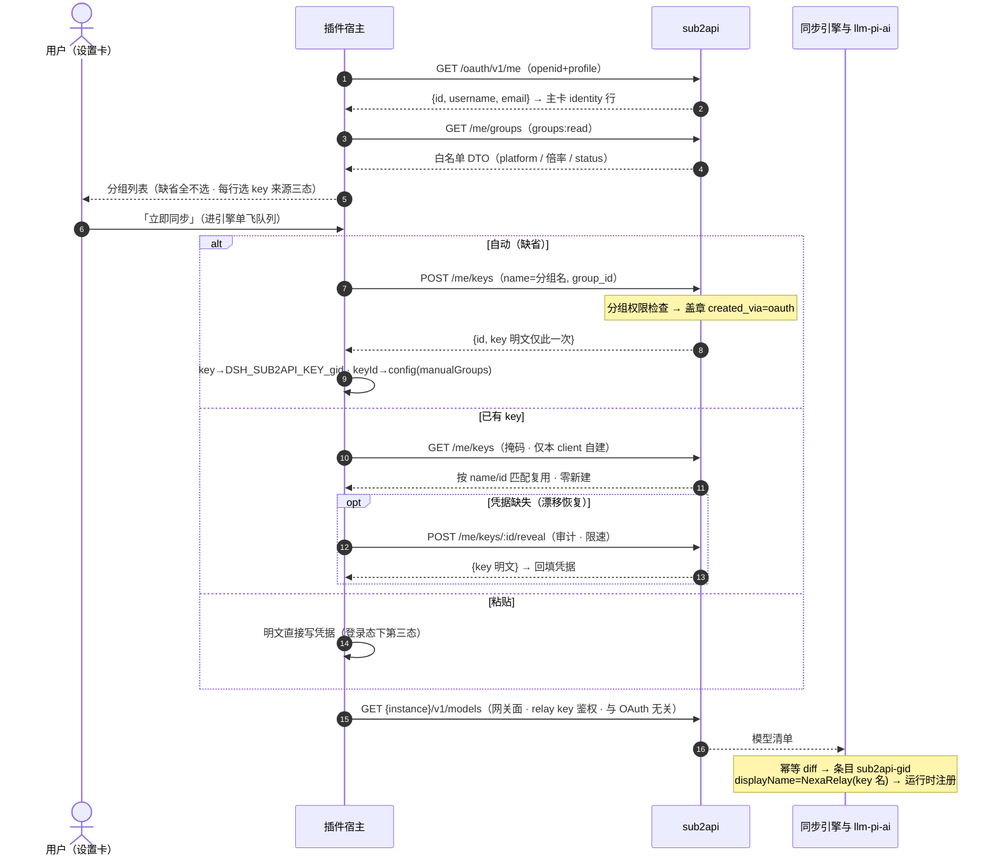
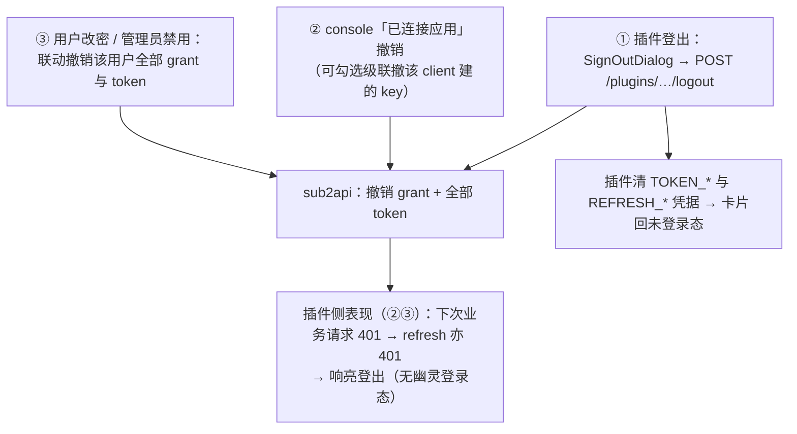
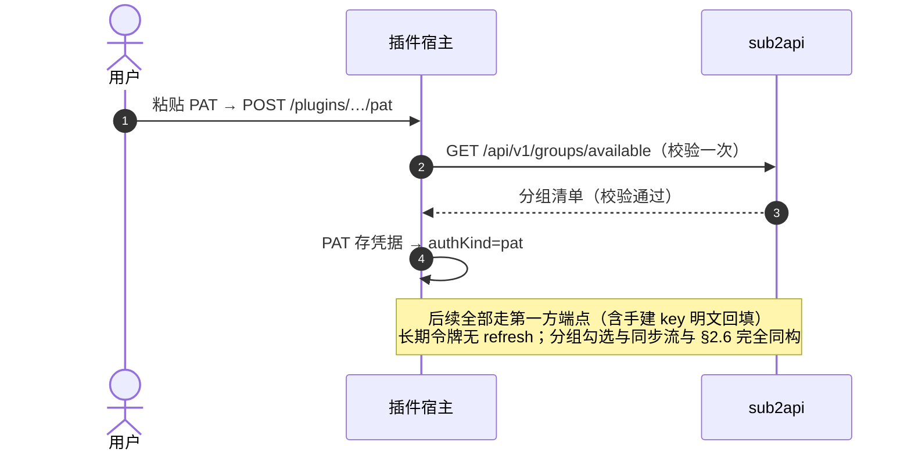

# sub2api OAuth 登录改造方案（双方案合并定稿）

Status: proposed · 2026-09-30（rev.3：基于上游 `Wei-Shaw/sub2api@main` 源码实测核验（§13，方案前提全部成立、行号锚点已校准），新增最小改造方案（§14，≈2 天可落地）。rev.2：叠加用户拍板 5 项（§1.1）——reveal 接受 / confidential / CF 可改 / 记住授权进 v1 / PAT 暂缓直接进 OAuth；全部图示 Mermaid。rev.1：合并《sub2api-sync 客户端 UI 改造方案》§12-B（下称 **UI 方案**）与《sub2api OAuth Provider 设计》（下称 **Provider 方案**）两份输入，冲突逐条裁决，形成 sub2api 侧可施工的权威定义）

输入溯源：

- **UI 方案**：本仓库 [`2026-09-30-sub2api-sync-client-ui.zh.md`](2026-09-30-sub2api-sync-client-ui.zh.md) §12（自改造清单：方案 A PAT / 方案 B OAuth / 方案 C webhook / 方案 D 拒 CORS）与 §5（插件 C2 通道客户端流）。该文档角度是「插件需要什么」，其 §12-B 是写给部署者的施工说明初稿。
- **Provider 方案**：独立设计的 OAuth 2.1 Authorization Code + PKCE Provider 完整方案（端点、数据表、前端页面、scope、安全测试、实施顺序）。该文档角度是「sub2api 该长什么样」，其源码锚点（`jwt_auth.go:39`、`api_key_service.go:460`、`routes/user.go:85`、`api_key_handler.go:320`、`dto/types.go:56`、`pending_auth_session.go:22`）以该文档作者核实为准（本机未检出 sub2api 仓库，行号引用不作二次验证）。

两份输入 80% 同向，8 处实质分歧。本文先裁决分歧（§1），再给出合并后的权威契约（§3–§8）、插件对接面（§9）与施工顺序（§11）。**本文取代 UI 方案 §12-B 的施工说明部分；UI 方案 §12-A（PAT）、§12-C/D 与插件侧 A1–A3 设计继续有效**，衔接变更见 §9.4。

---

## 0. 结论先行

1. **做 OAuth 2.1 Authorization Code + PKCE，token 形态取独立 opaque 双 token（不复用登录 JWT）**。撤销即时、scope 强制干净、第三方与第一方令牌语义隔离；代价（每请求一次查库 + 插件侧实现 refresh）小且都在既定改造范围内。这是两份输入最大的分歧，也是本合并最关键的一次取舍（§1-D1）。
2. **dsh 固定 Client v1 注册为 confidential（带 client_secret）+ PKCE 强制**（用户已拍板，§1.1-U2）。理由：dsh 的 code 换 token 发生在 harness 宿主进程（服务端形态），secret 不进浏览器；跨设备 web 场景下授权码会经过浏览器 URL（历史/扩展可及），交换环节多一把共享秘密是实打实的纵深。schema 仍保留 `client_type: public`，部署者可自行降为纯 PKCE 公开客户端（§1-D2）。
3. **资源端点隔离**：OAuth access token 只能调 `/api/v1/oauth/v1/me*` 独立端点族（scope 控权、掩码输出、来源审计）；第一方端点（`/api/v1/groups/available`、`/api/v1/keys`）继续服务 console 与 PAT 令牌。PAT（UI 方案 §12-A）**暂缓**（用户拍板直接进 OAuth，§1.1-U5），列为后续可补做的独立 P 期（§11）。
4. **consent 采用无状态重校验形态**（UI 方案）：`GET /authorize` 服务端校验通过后 302 → SPA `/oauth/consent`，consent 提交携全量原始参数由服务端重校验，**不建 pending 事务表**（Provider 方案的 transaction_id 模式不采用）；**「记住授权」进 v1**（§1.1-U4）——grant 已覆盖请求 scope 时 consent 自动续授，由 `oauth_grants` 表承担（§3.2）。
5. **key 明文纪律**：OAuth 通道除创建响应一次外全程掩码；插件「漂移恢复」（凭据缺失回填明文）由新增受控端点 `POST /me/keys/:id/reveal` 解决——仅限本 client 经 OAuth 创建的 key、单次、审计、限速（用户已拍板接受，§1.1-U1；§1-D7）。
6. **redirect_uri 精确匹配 + loopback 端口可变例外**（RFC 8252 §7.3）：DSH 桌面 web 服务器端口会变，回环 origin 不锁端口（path 恒为 `/plugins/dsh-sub2api-sync/oauth/callback`），跨设备反代 origin 逐条登记（§1-D8）。
7. 施工顺序（rev.2 拍板）：**Phase 1 OAuth 核心（含发现文档与 grants 查询端点，插件 A3 的前置从此刻起成熟）→ Phase 2 consent 前端（含记住授权自动续授）→ Phase 3 资源端点 + 审计 → Phase 4 运维**；PAT（原 Phase 0）暂缓为可补做的 P 期；插件侧 A3（C2 通道）从 Phase 1 末即可并行联调（§11）。

---

## 1. 分歧决策记录（合并的实质）

| # | 分歧点 | UI 方案 §12-B | Provider 方案 | **合并决策** | 理由 |
|---|---|---|---|---|---|
| D1 | access/refresh token 形态 | 复用现有登录 JWT（`/auth/refresh` 零改动续期） | 独立 opaque token（15 min / 30 d，哈希落库，rotation + family 撤销） | **取 Provider 方案：opaque 独立 token** | JWT 复用省下的工作量会被撤销需求吃回：JWT 撤销要另建 denylist，scope 强制要改 claims，且第三方令牌与第一方会话语义耦合。opaque 查库即可带出 scope/撤销态，成本是每请求一次查询（面板流量低，v1 直查，可选 60s 进程内缓存）。JWT 复用方案正式废弃，UI 方案 §12-B-3 相应作废 |
| D2 | client 类型 | public，无 client_secret（PKCE + 精确 redirect 承担安全） | confidential（v1 建议） | **confidential + PKCE 强制**（用户已拍板）；schema 双支持 `public\|confidential` | dsh 宿主是服务端进程，secret 可安全保存且不进浏览器；跨设备 web 下 code 过浏览器 URL，交换环节加共享秘密是有效纵深。纯浏览器型第三方将来用 public + PKCE 接入。UI 方案 §12-B-2「公钥客户端无需 client_secret」修订 |
| D3 | consent 提交形态 | 无状态：POST `/authorize` 携全量原始参数，服务端重校验 | transaction_id 事务表（`POST /authorize/approve`） | **取 UI 方案：无状态重校验**，不建事务表 | consent 页数据可由前端原样回传、服务端 POST 时全量重校验（client/redirect/scope/PKCE 逐项），安全性等价而少一张表和一个状态机；「记住授权」由 `oauth_grants` 承担（Provider 方案的 grants 表保留，v1 即启用自动续授） |
| D4 | scope 粒度 | `groups:read` + `keys:manage`（两档实现） | `openid profile groups:read keys:read keys:create keys:revoke` 六项 | **取 Provider 方案六项**；dsh 默认申请五项，`keys:revoke` 仅在启用 `deleteOrphanKeys` 时追加 | 细粒度让 consent 页可解释、审计可归因、最小授权可落实；scope 检查助手 ~20 行（Provider 方案「v1 完整」档），一步到位不做 `keys:manage` 粗档 |
| D5 | 第三方资源端点 | 隐含复用第一方端点（PAT 即插即用） | 独立 `/api/v1/oauth/v1/me*` 资源族 | **分工并存**：PAT → 第一方端点；OAuth token → 独立资源族 | PAT 是部署者自发的第一方令牌，直调第一方端点零改造（UI 方案 §12-A 成立）；OAuth 是第三方语义，独立端点族隔离 scope、安全策略与兼容性（Provider 方案理由成立）。插件面板半部按 `authKind: 'pat'\|'oauth'` 选端点族（§9.2） |
| D6 | `GET /authorize` 行为 | 「纯转发 302 → SPA，无任何逻辑」 | 服务端校验参数，错误渲染错误页 | **服务端校验，通过才 302**；client/redirect/scope/PKCE 无效 → 同源 SPA 错误页，**绝不 302 到未校验的 redirect_uri** | open redirect 是授权端点头号风险；「纯转发」是 UI 方案的安全疏漏，以此修正。校验逻辑与 consent POST 复用同一助手 |
| D7 | key 明文可见性 | 第一方 `/keys` 返回明文（实测已核实），插件据此回填凭据 | OAuth 通道一律掩码，明文只在创建时返回一次 | **OAuth 通道掩码 + 新增受控找回端点** `POST /me/keys/:id/reveal`（仅 `created_by_client_id = 本 client` 且 `created_via='oauth'` 的 key，单次、审计、限速）——用户已拍板接受（§1.1-U1） | 不破坏 Provider 方案「不暴露用户全部历史明文」的底线（过滤条件把暴露面钉死在本 client 自建 key）；同时保住插件漂移恢复路径（凭据缺失 + keyId 在 → 回填）。增量风险 ≈0：持本 client token 者本就有 `keys:create`，可建新 key，reveal 只是免掉孤儿 key。无此端点时插件响亮降级（§9.3） |
| D8 | redirect_uri 匹配 | 全串精确匹配，origin 可变靠管理页逐条登记 | 精确匹配；提及 loopback 单独受控实现 | **精确匹配 + 回环例外**：host ∈ {127.0.0.1, ::1, localhost} 且 scheme=http 时端口不参与匹配（RFC 8252 §7.3），path 精确相等；非回环全串精确 | DSH web 服务器端口随会话变化（如 127.0.0.1:19387），锁端口会让桌面用户每次重启都要重登记；RFC 8252 的 loopback 端口可变规则就是为这个场景设计的，且 path 精确匹配保持防钓鱼强度 |

### 1.1 已确认决策（2026-09-30，用户拍板）

| # | 事项 | 决策 | 落点 |
|---|---|---|---|
| U1 | reveal 受控找回端点 | **接受**（仅本 client 自建 key、单次、审计、限速 5/min、client 级开关 `allow_key_reveal`） | §3.5 `reveal` 行 |
| U2 | dsh client 类型 | **confidential**（secret 只进宿主凭据域 `DSH_SUB2API_OAUTH_SECRET_*`，不进浏览器/Config） | §4 seed、§9.1 凭据归宿 |
| U3 | Cloudflare 放行 | **可改**：部署前提 O1 落定（WAF：`/api/v1/*` → Skip 托管质询） | §10-O1 |
| U4 | 「记住授权」 | **v1 交付**：grant 未撤销且请求 scope ⊆ grant.scopes → consent 自动续授，不再人工确认；扩权或撤销后恢复正常确认 | §3.2、§7、§8.2 T29–T31 |
| U5 | PAT（原 Phase 0） | **暂缓，直接进 OAuth**；PAT 列为可补做的 P 期。P 期交付前「接管手建 key」无通道覆盖（只能 console 删掉重建），Turnstile 实例只能走 C2 或 C3 | §2.1、§11-P |

两份输入一致、直接采纳的部分（不再重复论证）：PKCE 仅 `S256`（拒绝 plain）；code 32 字节随机 base64url、sha256 落库、TTL ≤ 60s、原子一次性消费；redirect 白名单拒绝通配；`state` 由插件宿主自持自校验（不落 sub2api 库）；Turnstile/TOTP 永远在真实登录页由真人完成；Cloudflare 对 `/api/v1/*` 放行宿主侧调用（UI 方案 §12-0，U3 已确认可改）；不开 CORS（UI 方案 §12-D）；v1 不做完整 OIDC、不做动态客户端注册（Provider 方案最终建议）。

---

## 2. 目标形态与总体架构

### 2.1 三通道矩阵（合并后终态）

| 通道 | 依赖 | Turnstile/TCaptcha 实例 | key 明文回填 | key 管理 | 阶段 |
|---|---|---|---|---|---|
| **C1 PAT**（`POST /pat`） | sub2api P 期（PAT，**暂缓**，U5） | ✅ 天然绕过 | ✅（第一方 `/keys` 含明文） | 全量（第一方端点） | P 期 + 插件 A2（通道 UI 已备，仅等上游） |
| **C2 网页授权**（oauth/start → 浏览器 → callback） | 本文 Phase 1–3 | ✅ 真人在真实登录页过 | 🔶 仅限本 client 自建 key（reveal 端点，U1） | 仅本 client 自建 key | Phase 1 + 插件 A3 |
| **C3 密码 + 2FA** | 无上游改动 | ❌ 响亮指引 C1/C2 | — | — | 插件 A2（现状） |

> rev.2（U5）：C1 暂缓期间，Turnstile/TCaptcha 实例只能走 C2（Phase 1 后可用）；「接管手建 key」在 P 期交付前无通道覆盖。

### 2.2 总览：三通道汇入同一登录态



### 2.3 C2 网页授权主流程（成功路径，权威版）



### 2.4 失败与拒绝分支（各自在哪一步断）



### 2.5 续期：rotation 与重用检测（插件侧单飞）



### 2.6 授权完成后的同步流（「勾选即同步」全链）



### 2.7 撤销与登出（三个触发源，一个归宿）



### 2.8 C1 PAT 通道对照（P 期交付后可用）



---

## 3. 端点契约（sub2api 侧权威定义）

命名沿用 Provider 方案；`/api/v1/oauth/v1/` 双版本段是有意的（资源 API 版本独立于面板 API 演进）。

### 3.0 发现文档（插件能力探测的落点）

```
GET /api/v1/oauth/.well-known          （无需认证）
```

```json
{
  "issuer": "https://<instance>",
  "authorization_endpoint": "https://<instance>/api/v1/oauth/authorize",
  "token_endpoint": "https://<instance>/api/v1/oauth/token",
  "revocation_endpoint": "https://<instance>/api/v1/oauth/revoke",
  "scopes_supported": ["openid","profile","groups:read","keys:read","keys:create","keys:revoke"],
  "code_challenge_methods": ["S256"],
  "response_types_supported": ["code"],
  "grant_types_supported": ["authorization_code","refresh_token"]
}
```

UI 方案 §9-A3 的「能力探测：`GET {instance}/api/v1/oauth/.well-known` 或 authorize 端点探活」以此端点为准。v1 先发这个简版 JSON（Phase 1 交付）；RFC 8414 严格形态（`/.well-known/oauth-authorization-server/<issuer-path>`）留 Phase 4 可选项。

### 3.1 `GET /api/v1/oauth/authorize` — 授权入口（浏览器）

Query（全部必填，除 `state` 由插件保证存在外逐项校验）：

```
response_type=code
client_id=dsh
redirect_uri=https://127.0.0.1:19387/plugins/dsh-sub2api-sync/oauth/callback
scope=openid profile groups:read keys:create keys:read
state=<插件宿主自持的一次性随机串>
code_challenge=<base64url(sha256(verifier))>
code_challenge_method=S256
```

校验链（顺序执行，全部通过才重定向）：

1. `client_id` 存在且 `status=active`；
2. `response_type === 'code'`（否则 `unsupported_response_type`）；
3. `redirect_uri` 通过 §3.7 匹配规则（**不匹配 → 不做任何重定向**，302 到同源 SPA `/oauth/error?error=invalid_request`，日志记录完整请求）；
4. `scope` 逐项 ⊆ `client.allowed_scopes`（未知/越权 → `invalid_scope`，同样落 SPA 错误页）；
5. `code_challenge` 存在、`code_challenge_method === 'S256'`（plain 显式拒绝）、challenge 为合法 base64url(32B)；verifier 合法性在 token 端点验；
6. 全过 → `302 Location: {console-origin}/oauth/consent?<原 query 原样>`。

`state` 此端点只透传不解释（防 CSRF 责任在客户端，两输入一致）。

### 3.2 `POST /api/v1/oauth/authorize` — consent 提交（无状态）

认证：面板 Bearer JWT（现有 `jwt_auth.go` 中间件，`jwt_auth.go:39`——**这是全流程唯一用第一方 JWT 的位置**）。

```json
{
  "client_id": "dsh",
  "redirect_uri": "https://127.0.0.1:19387/plugins/dsh-sub2api-sync/oauth/callback",
  "scope": "openid profile groups:read keys:create keys:read",
  "state": "…",
  "code_challenge": "…",
  "code_challenge_method": "S256",
  "decision": "allow"
}
```

处理：

1. 服务端**全量重校验**（与 §3.1 同一助手：client/redirect/scope/PKCE 逐项）——consent 页回传的参数不可信，重校验是防篡改的唯一防线（D3 取无状态形态的对价）；
2. 用户状态检查（禁用用户 → 403，不发码）；
3. `decision === 'allow'` → 生成 code：32 字节随机 base64url，仅 sha256 hash 落 `oauth_authorization_codes`，TTL 60s，绑定 `user_id + client_id + redirect_uri + scope + code_challenge + method`；upsert `oauth_grants`（scopes 取本次并集，`approved_at=now()`）；审计 `oauth.authorize.allow`；
4. `decision === 'deny'` → 不生成任何 code，审计 `oauth.authorize.deny`；
5. 响应（两种决策同构，前端 `window.location.href = redirect`）：

```json
{ "redirect": "https://127.0.0.1:19387/plugins/dsh-sub2api-sync/oauth/callback?code=…&state=…" }
{ "redirect": "https://127.0.0.1:19387/plugins/dsh-sub2api-sync/oauth/callback?error=access_denied&state=…" }
```

Provider 方案的 transaction_id/`/authorize/approve` 不实现（D3）。

**「记住授权」v1 交付（U4）**：新增配套查询端点 `GET /api/v1/oauth/grants/current`（Bearer JWT；返回 `{client_id, scopes, approved_at}` 或 404）。consent 页加载时先查它：grant 未撤销且请求 scope ⊆ grant.scopes → 前端直接以 `decision=allow` 提交（无感续授，页面一闪而过并提示「已沿用之前授予的权限」）；请求 scope 超出 grant.scopes（扩权）或 grant 已撤销 → 正常展示人工确认。批准后服务端 upsert grants（scopes 取并集）。「已连接应用」页撤销 grant 后，下次授权自然回到人工确认。自动续授是**前端行为、服务端重校验兜底**——不引入服务端状态，与 D3 无状态形态自洽。

### 3.3 `POST /api/v1/oauth/token` — 令牌端点（公开，client 鉴权按类型）

`Content-Type: application/x-www-form-urlencoded`；confidential client 凭 `client_secret`（HTTP Basic 优先，form 字段兼容；RFC 6749 §2.3.1）；public client 不带 secret。

**grant_type=authorization_code**

```
grant_type=authorization_code
client_id=dsh
client_secret=…            (confidential)
code=<一次性授权码>
redirect_uri=<与 authorize 完全一致>
code_verifier=<43–128 字符 [A-Za-z0-9\-._~]>
```

校验链：client 有效（类型/状态/secret）→ code hash 查找 → 未过期（60s）→ **原子消费**（`UPDATE oauth_authorization_codes SET consumed_at=now() WHERE code_hash=? AND consumed_at IS NULL`，affected=0 → `invalid_grant`，审计重放）→ `client_id`/`redirect_uri`/`user_id` 与授权记录一致 → `base64url(sha256(code_verifier)) == code_challenge` → 全过签发。

**grant_type=refresh_token**

```
grant_type=refresh_token
client_id=dsh
client_secret=…
refresh_token=<srt_…>
```

校验链：client 有效 → refresh hash 查找 → 未撤销/未过期 → 属于本 client → **rotation**：旧 token 标 `rotated_at`，签发新 access + 新 refresh（继承 `family_id`，scope 不变）→ 旧 refresh 再次出现（重用检测）→ **撤销整个 family + 该 (client_id, user_id) 名下全部 access token**，审计 `oauth.token.reuse_detected`。插件侧必须「收到新 refresh 立即持久化」（§9.2）。

**成功响应（两种 grant 同构）**

```json
{
  "access_token": "sat_<32B base64url>",
  "token_type": "Bearer",
  "expires_in": 900,
  "refresh_token": "srt_<32B base64url>",
  "scope": "openid profile groups:read keys:create keys:read"
}
```

**错误响应**（RFC 6749 §5.2，HTTP 400/401）：

```json
{ "error": "invalid_grant", "error_description": "authorization code expired" }
```

取值：`invalid_request` / `invalid_client`（401）/ `invalid_grant` / `unsupported_grant_type` / `invalid_scope`。**日志与错误描述永不回显 code/token/verifier 原文。**

TTL 基线：access 900s、refresh 30d（Provider 方案建议值）；两者进可调配置。

### 3.4 `POST /api/v1/oauth/revoke`（RFC 7009）

```
token=<access 或 refresh>
token_type_hint=access_token|refresh_token
client_id=dsh
client_secret=…        (confidential)
```

- hash 查找两类表，命中即撤销（access → `revoked_at`；refresh → 撤销其 family，连带该 (client_id,user) access）；
- 按规范**总是返回 200**（即使 token 无效）——不向攻击者泄露 token 有效性；
- 触发方：插件登出、用户在「已连接应用」撤销、管理员封禁 client、用户密码变更联动（§10）。

### 3.5 资源端点族 `/api/v1/oauth/v1/me*`（OAuthAccessTokenMiddleware 保护）

| 端点 | scope | 行为 |
|---|---|---|
| `GET /me` | `openid` + `profile` | `{id, username, email}`——仅此三项；**不返回**管理员字段、内部备注、余额明细、风控字段（Provider 方案红线） |
| `GET /me/groups` | `groups:read` | 复用 `groups/available` 领域查询（`routes/user.go:85`、`api_key_handler.go:320`），**输出白名单字段**：`id, name, description, platform, rate_multiplier, status, subscription_type, is_exclusive, claude_code_only, daily/weekly/monthly_limit_usd, allow_image_generation`；fork 内部字段不透传 |
| `GET /me/keys` | `keys:read` | **仅 `created_via='oauth' AND created_by_client_id = token.client_id` 的 key**；掩码输出 `{id, name, group_id, masked_key:"sk-sub2api-****abcd", status, expires_at, created_at}`；永不返回明文 |
| `POST /me/keys` | `keys:create` | 复用 `APIKeyService` 创建链 + 分组权限检查（`api_key_service.go:460`、DTO `dto/types.go:56`）；body `{name, group_id, expires_in_days?, quota?, rate_limit_5h?}`；服务端重查用户-分组绑定；**盖章 `created_via='oauth'`、`created_by_client_id`**；响应仅在创建成功这一次含 `key` 明文；审计（含 IP/UA/scope） |
| `POST /me/keys/:id/reveal` | `keys:read` | **受控找回（U1 拍板接受）**：仅 `created_via='oauth' AND created_by_client_id = token.client_id`；响应 `{key:"sk-sub2api-…"}`；审计 `oauth.key_reveal`（who/which/when/IP）；限速 5/min/user；client 级可关（`allow_key_reveal` 字段，缺省 true） |
| `DELETE /me/keys/:id` | `keys:revoke` | 仅限本 client 自建的 key（同上过滤）；软删/撤销语义复用第一方吊销链；审计 |

分组绑定权限、key 配额/限额字段校验**全部复用既有第一方实现**——资源端点只做「scope 检查 + 来源盖章 + 输出裁剪」三件新事，不复制业务逻辑。

### 3.6 `GET /me/keys` 的复用语义（插件联动）

插件「选已有 key」在 OAuth 通道下只能看到**本 client 自建**的 key（最小暴露，D5/D7 推论）：手动在 console 建的同名 key 不可见 → 自动模式按组名匹配会新建一把（无害，console 可辨）。需要接管手建 key 的用户走 C1 PAT 通道（第一方 `/keys` 全量可见含明文；P 期交付前该场景无覆盖，见 §2.1 注）。此差异写入插件 UI 的通道说明文案（§9.3）。

### 3.7 redirect_uri 匹配规则（单一助手，authorize 与 token 两端共用）

```
matchRedirectURI(registered: string[], presented: string): boolean
  1. 解析两者；scheme、host 必须完全一致（大小写规范化 host）
  2. host ∈ {127.0.0.1, ::1, localhost} 且 scheme === 'http'
       → 端口不参与比较（RFC 8252 §7.3）；否则端口必须相等
  3. path + query 必须逐字符相等（本场景 path 恒 /plugins/dsh-sub2api-sync/oauth/callback，无 query）
  4. 拒绝一切通配/前缀/包含匹配
```

测试矩阵进 §8（含 IPv6 回环、端口漂移、path 篡改、https→http 降级、非回环端口不同）。

---

## 4. 数据模型（Ent schema，5 新表 + 1 表加列）

全部取 Provider 方案表结构（UI 方案的简化 `oauth_clients` 是其子集，弃用），字段与索引如下；哈希一律 sha256，**任何表不存明文 token/code/secret**。

| 表 | 字段 | 索引/约束 |
|---|---|---|
| `oauth_clients` | `id, client_id(unique), client_secret_hash?, name, description?, logo_url?, client_type(public\|confidential), redirect_uris(jsonb), allowed_scopes(jsonb), pkce_required(bool,默认true), allow_key_reveal(bool,默认true), status(active\|disabled), created_by, created_at, updated_at` | `client_id` unique |
| `oauth_authorization_codes` | `id, code_hash, client_id, user_id, redirect_uri, scope, code_challenge, code_challenge_method, expires_at, consumed_at?, created_at` | `code_hash` unique；`(client_id,user_id)`；TTL 清理任务（>10min 即可删） |
| `oauth_access_tokens` | `id, token_hash, client_id, user_id, scope, expires_at, revoked_at?, created_at, last_used_at` | `token_hash` unique；`(client_id,user_id)`（联动撤销用）；`(user_id)` |
| `oauth_refresh_tokens` | `id, token_hash, family_id, client_id, user_id, scope, expires_at, revoked_at?, rotated_at?, created_at` | `token_hash` unique；`family_id`；`(client_id,user_id)` |
| `oauth_grants` | `id, client_id, user_id, scopes(jsonb), approved_at, revoked_at?, updated_at` | `(client_id,user_id)` unique |
| `api_keys`（加列） | `created_via(varchar,默认'panel'), created_by_client_id(varchar,?)` | `(created_by_client_id)`；审计/过滤依赖 |

dsh 固定 Client 的 v1 注册（confidential，U2）：配置文件内建（迁移时 seed，Provider 方案 yaml 形态），Phase 4 换管理页维护：

```yaml
oauth:
  clients:
    - client_id: dsh
      name: DeepSeek Harness · Sub2API 同步
      client_type: confidential
      pkce_required: true
      allow_key_reveal: true
      redirect_uris:
        - "http://127.0.0.1/plugins/dsh-sub2api-sync/oauth/callback"   # 回环：端口不参与匹配
        # 跨设备反代 origin 由部署者逐条追加，管理页「一键登记当前 harness origin」辅助
      allowed_scopes: [openid, profile, groups:read, keys:read, keys:create, keys:revoke]
```

（secret 由迁移生成并仅创建响应一次展示，交部署者填入插件凭据 `DSH_SUB2API_OAUTH_SECRET_*`。）

---

## 5. 鉴权中间件与 scope 执行

### 5.1 `OAuthAccessTokenMiddleware`（新增，Provider 方案 §二-3）

解析 `Authorization: Bearer sat_…` → sha256 → 查 `oauth_access_tokens` → 校验未撤销/未过期 → 查 client（`status=active`）→ 查 user（`status=active`，禁用用户令牌即时失效）→ 注入 `ctx {oauthUserID, oauthClientID, oauthScope}` → 节流更新 `last_used_at`（距上次 >60s 才写，防写放大）。

v1 每请求直查（面板流量低）；可选项：token_hash 前 8 字节为 key 的 60s 进程内 LRU（撤销延迟上限 60s，文档注明）。**不与 `jwt_auth.go` 共用逻辑，两条中间件并存**（第一方走 JWT，第三方走 OAuth——Provider 方案的隔离要求）。

### 5.2 scope 检查助手（~20 行）

```go
func RequireScope(c *gin.Context, scope string) bool   // 不满足 → 403 {error:"insufficient_scope"}
```

资源路由组按 §3.5 表逐路由挂载。`jwt_auth.go` 第一方中间件零改动。

### 5.3 后端代码拆分（Provider 方案 §五全收，追加 2 文件）

```
backend/internal/handler/oauth_provider_handler.go        // authorize GET/POST、token、revoke、discovery、grants/current
backend/internal/handler/oauth_resource_handler.go        // /me、/me/groups、/me/keys、reveal（拆出，避免单文件膨胀）
backend/internal/service/oauth_provider_service.go        // 校验链、code 生命周期、grant upsert/查询、redirect 匹配助手
backend/internal/service/oauth_token_service.go           // 签发/rotation/family 撤销/哈希
backend/internal/server/routes/oauth_provider.go          // RegisterOAuthProviderRoutes(...)
backend/internal/server/middleware/oauth_access_token.go
backend/ent/schema/oauth_client.go
backend/ent/schema/oauth_authorization_code.go
backend/ent/schema/oauth_access_token.go
backend/ent/schema/oauth_refresh_token.go
backend/ent/schema/oauth_grant.go
```

复用（不复制业务）：`AuthService`（用户查找/状态）、`UserService`（/me 资料）、`APIKeyService`（创建/查询/吊销 + 分组权限检查）、`SettingService`（站点配置）、`AuditLogService`（全部事件）。**不复用** `pending_auth_session`（`pending_auth_session.go:22`）作授权码表——那是浏览器登录/注册流程的状态机；其 Cookie/防重放/过期设计可借鉴，OAuth code 用独立表独立状态机（Provider 方案明令）。

---

## 6. 审计事件（AuditLogService 挂点）

| 事件 | 载荷 |
|---|---|
| `oauth.authorize.allow / deny` | client_id, user_id, scope, redirect_host, IP, `auto_grant: bool`（U4 自动续授标记） |
| `oauth.code.consumed / replay_detected` | client_id, user_id |
| `oauth.token.issue / refresh / rotate / reuse_detected` | client_id, user_id, scope, family_id |
| `oauth.revoke` | 来源（plugin_logout / user_revoke / admin / password_change） |
| `oauth.key.created_via_oauth / revoked / reveal` | client_id, user_id, key_id, IP, UA |

日志红线：code、access/refresh token、client_secret、API key 明文**永不入日志**（Provider 方案 §七-密钥安全）。

---

## 7. console 前端改造（4 页）

| 页面 | 路由 | 文件（建议） | 职责 |
|---|---|---|---|
| **consent 页**（Provider 方案 AuthorizeView 的职责，命名随 UI 方案 SPA 路由） | `/oauth/consent` | `frontend/src/views/oauth/OAuthConsentView.vue` | 读 query 全量参数 → 展示 client 名/Logo/scope 人话清单（「查看基本资料 / 查看可用分组 / 创建 API Key」+「不会获得：管理员权限、其他用户信息、上游账号 OAuth Token、你的登录密码」）→ allow/deny 调 `POST /api/v1/oauth/authorize`（Bearer JWT）→ `window.location.href = resp.redirect`；**记住授权（U4）**：加载时先调 `GET /api/v1/oauth/grants/current`，grant 覆盖请求 scope → 直接 allow 提交（提示「已沿用之前授予的权限」），扩权/未授权/已撤销 → 人工确认；未登录 → 跳现有登录页 `?next=/oauth/consent?…`（Turnstile/TOTP 零改动，UI 方案 §12-B-4） |
| **错误页** | `/oauth/error` | `frontend/src/views/oauth/OAuthErrorView.vue` | 未注册 client / redirect 不匹配 / scope 越权 / PKCE 参数错 / 请求过期 / 用户拒绝的兜底展示；**redirect_uri 不可信时由后端直接落本页（同源），绝不回跳攻击者地址**；不回显敏感参数 |
| **已连接应用** | `/settings/security/connected-apps` | `frontend/src/views/user/ConnectedAppsView.vue` | 读 `oauth_grants`：应用名、已授权 scope、最近使用（取 token.last_used_at 聚合）、[撤销授权] → 调 `/revoke`（撤销 grant + 全部 token；可选勾选「同时撤销该应用创建的 API Key」）。撤销后记住授权自然失效 |
| **管理端 Client 页**（Phase 4） | `/admin/oauth-clients` | `frontend/src/views/admin/OAuthClientsView.vue` | 创建/编辑 client、redirect URI 增删（含「一键登记当前 harness origin」辅助——粘贴 `http://127.0.0.1:<port>/plugins/…` 自动落成回环登记）、scope 白名单、secret 轮换（仅展示一次）、启停、最近授权/撤销记录 |

Phase 1–3 期间 dsh client 走配置文件 seed（§4），管理页不阻塞主线。

---

## 8. 安全规则与测试矩阵

### 8.1 硬性规则（评审 checklist）

1. token/code/secret 只存哈希；明文只在创建响应出现一次；
2. code：60s TTL、原子一次性消费、绑定五元组（user/client/redirect/scope/challenge）；
3. PKCE 仅 S256；verifier 43–128 且字符集合法；
4. redirect 匹配走单一助手（§3.7），authorize 与 token 两端共用；
5. redirect 不可信时**零重定向**（同源错误页）；
6. `state` 不落 sub2api 库（客户端职责）；`nonce`/OIDC 不做（v1 非 OIDC）；
7. refresh rotation + 重用即 family 全撤销 + 名下 access 连带撤销；
8. 禁用用户/密码变更 → 该 user 全部 grant+token 撤销（§10）；
9. 资源端点输出白名单裁剪；`/me/keys` 仅本 client 自建 key；
10. 日志零敏感原文；错误页零敏感参数回显；
11. **自动续授仅当 grant 未撤销且请求 scope ⊆ grant.scopes**（U4）；扩权必须人工确认。

### 8.2 测试矩阵（两输入去重合并 + U4 新增；每行一条自动化用例）

**OAuth 核心**

| # | 用例 | 预期 |
|---|---|---|
| T1 | 未知 `client_id` | authorize 拒绝，落同源错误页 |
| T2 | `redirect_uri` 不精确匹配（含前缀/通配/path 篡改/非回环端口不同） | authorize 与 token 两端点均拒绝；authorize **不重定向**到该地址 |
| T3 | 回环端口漂移（注册 `http://127.0.0.1/…`，请求 `http://127.0.0.1:任意/…`） | 通过（RFC 8252 §7.3） |
| T4 | 未注册 scope / scope 超出 client 白名单 | 拒绝（`invalid_scope`） |
| T5 | 缺 PKCE / `code_challenge_method=plain` / verifier 长度或字符集非法 | 拒绝 |
| T6 | `code_verifier` 错误 | token 端点 `invalid_grant` |
| T7 | 同一 code 第二次换 token | 拒绝；审计 replay |
| T8 | code 过期（>60s） | 拒绝 |
| T9 | code 换 client 使用 / redirect_uri 与授权时不一致 | 拒绝 |
| T10 | refresh rotation：新 token 可用、旧 token 立即失效 | 通过 |
| T11 | refresh 重用（已 rotate 的 token 再次出现） | family 全撤销 + 名下 access 撤销；审计 reuse |
| T12 | `/revoke` 后立即调用资源端点 | 401；`/revoke` 对无效 token 仍返回 200 |
| T13 | confidential client 缺/错 `client_secret` | `invalid_client`（401） |

**用户与分组权限**

| # | 用例 | 预期 |
|---|---|---|
| T14 | OAuth token 读 `/me/groups` 只见自己的分组 | 通过；越权分组不可见 |
| T15 | `POST /me/keys` 绑定无权分组 | 拒绝（复用第一方检查） |
| T16 | 禁用用户的 OAuth token | 立即 401 |
| T17 | 撤销授权（grant 级） | 全部 token 失效；自动续授同时失效 |
| T18 | `keys:create` 不能创建管理员 key / 越过配额策略 | 拒绝（复用第一方策略） |
| T19 | `GET /me/keys` | 仅本 client 自建 key、仅掩码 |
| T20 | `reveal` 非 client 自建 key | 拒绝；命中限速（5/min）后 429 |

**密钥与日志**

| # | 用例 | 预期 |
|---|---|---|
| T21 | 全链路日志扫描 | 无 code/token/secret/key 明文 |
| T22 | 创建响应外任何端点 | 不返回 key 明文（reveal 除外且已审计） |
| T23 | deny 决策 | 回调带 `error=access_denied&state=…`，无 code |
| T24 | 错误页 | 不回显 redirect_uri/scope 等参数原文 |

**记住授权（U4 新增）**

| # | 用例 | 预期 |
|---|---|---|
| T29 | grant 存在且请求 scope ⊆ grant.scopes | consent 自动续授（直接 allow），无感发码；审计带 `auto_grant:true` |
| T30 | 请求 scope 超出 grant.scopes（扩权） | 正常展示人工确认；批准后 grant scopes 取并集 |
| T31 | grant 已撤销后再授权 | 重新展示人工确认；自动续授不残留 |

**端到端（= UI 方案 §12-B-6 全收）**

| # | 用例 |
|---|---|
| T25 | 未登录走 authorize → 登录页（Turnstile/TOTP 照常）→ consent → redirect 带 code/state |
| T26 | 插件全流：网页授权 → 分组勾选 → 建 key 同步 → 模型选择器下一请求可用 |
| T27 | 插件登出 → `/revoke` → 旧 token 全失效；重新授权可恢复 |
| T28 | 漂移恢复：删凭据留 keyId → reveal 回填成功（限自建 key） |
| T32 | 二次授权全链：已授权过的 client 再次网页登录 → 自动续授无感完成（U4 体验验收） |

---

## 9. DSH 插件侧对接契约

UI 方案 §5 的三条宿主路由（`/plugins/dsh-sub2api-sync/oauth/start|callback|status`）与客户端流（§5.2 步骤 1–7）不变，以下为合并后的修订与细化。

### 9.1 宿主半部新增/修订（对 UI 方案 A1/A3 的 delta）

| 项 | 内容 |
|---|---|
| PKCE | 宿主生成 `code_verifier`（43–128，`[A-Za-z0-9\-._~]`）与 `S256` challenge；verifier 只存 attempt 内存，不落盘不进日志 |
| state | 一次性随机串，绑定 attempt（instance + 时间戳），TTL 10min，消费即焚；`/oauth/callback` 校验失败 → 响亮过期/失败 phase（SignInDialog `expired`/`failed`） |
| authorizeUrl | `{instance}/api/v1/oauth/authorize?response_type=code&client_id={oauthClientId}&redirect_uri={origin}/plugins/dsh-sub2api-sync/oauth/callback&scope=…&state=…&code_challenge=…&code_challenge_method=S256`；`window.open(url,'_blank','noopener')` + copy-link 兜底（官方同款） |
| token 交换 | 宿主侧 `POST /api/v1/oauth/token`（Basic auth 带 client_secret，U2；form-urlencoded）；成功后 access/refresh 分落 credentials |
| 凭据归宿 | access → `DSH_SUB2API_TOKEN_<hash>`（既有 `panelTokenRef`）；refresh → `DSH_SUB2API_REFRESH_<hash>`（既有 `panelRefreshRef`）；**client_secret → 新增 `DSH_SUB2API_OAUTH_SECRET_<hash>`**（U2）；`client_id`（非秘密）→ Config 新字段 `oauthClientId` |
| 刷新 | 单飞（并入引擎既有 single-flight 队列）：401 → `grant_type=refresh_token` → **新 refresh 立即持久化再继续**（rotation 语义下，写失败=下次重用旧 token=family 撤销，必须先写）；refresh 失效 → 响亮登出并引导重新授权 |
| authKind | Config 派生 `authKind: 'pat' \| 'oauth'`（PAT 凭据在 → pat；OAuth token 在 → oauth；都无 → 未登录）。面板 client 按下表选端点族 |
| scope 申请 | 缺省 `openid profile groups:read keys:create keys:read`；启用 `deleteOrphanKeys` 时追加 `keys:revoke`（扩权 → 服务端走人工确认，见 T30） |
| 能力探测 | `GET {instance}/api/v1/oauth/.well-known`（§3.0）；404/失败 → 隐藏 C2 入口（UI 方案 A3 前置判断的落点） |

### 9.2 端点族映射（插件面板 client 按 authKind 切换）

| 插件能力 | PAT（第一方端点） | OAuth（资源端点） |
|---|---|---|
| 分组发现 | `GET /api/v1/groups/available` | `GET /api/v1/oauth/v1/me/groups` |
| key 列表 | `GET /api/v1/keys`（含明文，实测契约） | `GET /me/keys`（掩码，仅本 client 自建） |
| 建 key（自动模式，名=组名） | `POST /api/v1/keys` | `POST /me/keys`（明文一次 → 落 `DSH_SUB2API_KEY_<gid>`） |
| 漂移恢复（凭据缺失+keyId 在） | List 明文回填（UI 方案 §5.1 既有设计） | `POST /me/keys/:id/reveal`（限自建 key，U1；失败→响亮，指引 PAT 或重建） |
| 孤儿 key 清理 | `DELETE /api/v1/keys/:id` | `DELETE /me/keys/:id`（需 `keys:revoke`） |
| 账号显示 | — | `GET /me` → username 填主卡 identity 行（UI 方案 §4.4） |
| 续期 | PAT 长期有效，无需 | refresh rotation（§9.1） |

### 9.3 OAuth 通道的能力差异（UI 文案必须写明）

1. 「选已有 key」列表仅含**本 client 经 OAuth 创建**的 key；接管手建 key 请用 PAT 通道（P 期交付前无覆盖，console 删掉重建）；
2. 同名手建 key 不可见 → 自动模式可能同名新建（无害）；
3. 非 client 自建 key 的 reveal 必然失败 → 响亮提示「该 key 非 OAuth 通道创建，请改用 PAT 通道或重新以自动模式建 key」。

### 9.4 对 UI 方案的回写（其文档下次修订时采纳）

1. §12-B 施工说明 → 由本文取代（端点/数据模型/安全以本文 §3–§5 为准）；
2. §12-B-3「签发复用现有 login JWT 函数」→ 废弃（D1）；
3. §12-B-1「authorize 为纯转发无任何逻辑」→ 修订为「服务端校验，通过才 302」（D6）；
4. §5.1 凭据清单追加 `DSH_SUB2API_OAUTH_SECRET_<hash>`；A1 宿主半部追加 `oauthClientId` Config 字段与 `authKind` 派生；
5. A3 前置从「§12 方案 B 部署完成」细化为「Phase 1 + `/.well-known` 可达」（Phase 2/3 未完成时 authorize/token 已可端到端，consent 页可先用 console 临时页面顶替联调）；
6. §12-A PAT 的插件侧依赖不变，但交付时序后置（U5）：A2 的 C1 通道入口按 `.well-known` 同思路做 PAT 能力探测（`GET /api/v1/tokens` 探活），不可用即隐藏。

---

## 10. 部署前提与运维

| # | 事项 | 内容 |
|---|---|---|
| O1 | **Cloudflare 放行**（实例前置 CF 的场合）✅ **已确认可改（U3）** | WAF 规则：`http.request.uri.path starts_with "/api/v1/"` → Skip 托管质询。宿主侧调用（token 换发、refresh、资源端点、reveal）是 harness 服务器的纯 HTTP 请求，无 cf_clearance；浏览器侧（登录页/consent/redirect）有人类通行证不受影响 |
| O2 | 速率限制（Phase 4） | token 端点 10/min/IP；consent POST 适度；reveal 5/min/user（§3.5）；authorize 探测类不设 |
| O3 | 联动撤销（Phase 4） | 用户改密码 → 撤销其全部 grant+token；管理员禁用用户 → 同（中间件 T16 已兜即时失效，此处清库） |
| O4 | 数据清理 | 过期 code（>10min）、撤销超 30d 的 token 行定期清理任务 |
| O5 | 时钟 | TTL 判断全部服务端 UTC；无需部署方额外配置 |

---

## 11. 实施阶段与验收

| Phase | 内容（sub2api 侧） | 验收判据 |
|---|---|---|
| **P · PAT**（暂缓·可补做，≈1 天；U5） | `personal_access_tokens` 表、`GET/POST /api/v1/tokens`、`DELETE /tokens/:id`、PAT 鉴权分支、console「访问令牌」区；仅覆盖 `/api/v1/*`，不覆盖网关 `/v1/*` | 创建响应仅一次明文；吊销后立即 401；插件 C1 通道全流（粘贴 → 校验一次 → 分组勾选 → 同步）；**手建 key 接管自此补齐** |
| **1 · OAuth 核心**（2–3 天） | §4 五表迁移 + dsh client seed（confidential，U2）；`GET/POST /api/v1/oauth/authorize`（校验链 + 无状态 consent POST）；`POST /oauth/token`（code+refresh、PKCE S256、rotation、family 撤销）；`matchRedirectURI` 助手；`GET /api/v1/oauth/.well-known`；`GET /api/v1/oauth/grants/current`（U4）；§5 中间件与 scope 助手骨架 | §8.2 T1–T13 全绿；`.well-known` 可探测 |
| **2 · consent 前端**（1–2 天） | `/oauth/consent`（**含记住授权自动续授**，U4）、`/oauth/error`、登录 `?next=` 跳转复用、已连接应用页 | T23/T24 + T29–T31；UI 方案 §12-B-6 用例 1/4；Turnstile/TOTP 实例走通全流程 |
| **3 · 资源端点 + 审计**（1–2 天） | `/me`、`/me/groups`、`/me/keys`（掩码/创建/吊销）、`reveal`（U1）；`api_keys` 审计加列；§6 审计事件全挂 | T14–T22、T28 全绿；第一方端点行为零回归 |
| **4 · 运维**（1 天+） | 管理端 Client 页（secret 轮换/redirect 增删/启停）、`/revoke` 联动、O2–O4 | O1–O4 逐项演示；T27 通过 |
| **A3 · 插件侧（并行）** | UI 方案 A3 三路由 + §9.1 delta（PKCE/state/authKind/refresh 单飞/OAUTH_SECRET 凭据/能力探测）+ C2 UI | 前置 = Phase 1 末；验收 = UI 方案 A3 验收 + T25–T28、T32 联调全过 + 「勾选已有 key 的分组零新建 key」（P 期后走 PAT 通道验收） |

联调顺序建议：Phase 1 完成 → 用 curl 脚本走通 T1–T13 → 插件 A3 接入（此时 consent 可用 console 临时页）→ Phase 2/3 完成后换正式页面回归 T25–T32。P 期（PAT）可在任意时点独立插入，不阻塞主线。

---

## 12. 非目标（合并定稿）

- **不做完整 OIDC**（无 id_token/nonce/UserInfo 标准声明集；`/me` 是本方案自定义的最小资源端点）；
- **不做动态客户端注册**（DCR）；client 由配置 seed + 管理页维护；
- **不开 CORS**（UI 方案 §12-D 原样：面板 token 不进浏览器进程，保持「浏览器半部 → harness 宿主路由 → sub2api」代理形态）；
- **不复用登录 JWT 作第三方 token**（D1，含「共用 `/auth/refresh`」的捷径）；
- **不建 pending 事务表**（D3）；
- **不把 `pending_auth_session` 当授权码存储**（Provider 方案明令）；
- **OAuth 通道不返回非 client 自建 key 的明文**（D7 边界）；全量 key 管理（含明文回填）是 PAT 通道的职责（P 期交付）；
- 分组变更 webhook（UI 方案 §12-C）与 RFC 8414 标准 discovery 仍为可选项，不阻塞主线。

---

## 13. 上游源码核验（`Wei-Shaw/sub2api@main`，2026-09-30 实测）

核验方法：`gh api` 拉取 main 分支文件树（4431 文件）与关键源码逐文件比对。结论先行：**方案全部前提在上游成立，可行；无结构性障碍，仅行号锚点漂移与两处「可更大程度复用」的发现**（refresh 机制已存在、限流/审计件现成）。

### 13.1 锚点校准（Provider 方案所引行号 → 实测）

| 原锚点 | 实测（main，2026-09-30） | 判定 |
|---|---|---|
| `jwt_auth.go:39` | `backend/internal/server/middleware/jwt_auth.go:39` 即 `return func(c *gin.Context)` | ✓ 精确 |
| `routes/user.go:85` groups/available | `routes/user.go:88`（`groups.GET("/available", h.APIKey.GetAvailableGroups)`） | ✓ 漂移 3 行 |
| `api_key_handler.go:320` | `api_key_handler.go:322`（GetAvailableGroups）；Create 在 :182 | ✓ 漂移 2 行 |
| `api_key_service.go:460` | `api_key_service.go:492`（Create）；`canUserBindGroup` :481；`checkAPIKeyCreateLimits` :444 | ✓ 漂移 ~30 行 |
| `dto/types.go:56` | dto 按实体拆分（`dto.GroupFromService` 等），语义成立 | ✓ |
| `pending_auth_session.go:22` | `backend/ent/schema/pending_auth_session.go` 存在；另有 `auth_oauth_pending_flow.go` | ✓「不复用」结论维持 |

### 13.2 方案前提逐项核验

| 方案前提 | 上游证据 | 判定 |
|---|---|---|
| Gin + 路由注册模式 | `router.go` `registerRoutes` → `routes.RegisterXxxRoutes(v1, h, …)` 模式统一 | ✓ `RegisterOAuthProviderRoutes` 插入点现成 |
| SPA 同源 + history 路由 | 同进程嵌入前端（`router.go:74-90`）；`createWebHistory`（`router/index.ts:6`）；已有 `/auth/callback` 等无守卫路由先例（`requiresAuth:false` 白名单） | ✓ authorize 302 → `/oauth/consent` 同源成立，且无需 hash 前缀 |
| 登录页验证码 + 2FA | `auth_handler.go` Login：`captchaProof`（Turnstile/腾讯验证码）→ `VerifyCaptcha`；`Login2FA` 返回 `TotpLoginResponse` 临时 token；另有 passkey | ✓ C2「真人在真实登录页过验证码」的价值前提成立 |
| console 凭据形态 | `stores/auth.ts`：localStorage `auth_token`/`refresh_token` + 120s buffer 自动刷新（`api/client.ts` 拦截器） | ✓ UI 方案 B3 前提复核成立；consent POST 带 Bearer 可行 |
| **refresh token 机制（重大发现）** | `auth_service.go`：opaque `rt_`+32B、sha256 落 Redis（`repository/refresh_token_cache.go`）、**family set + 重用检测（`ErrRefreshTokenReused`）+ rotation**、`GenerateTokenPair(user, familyID)`、`RevokeAllUserSessions` | ✓✓ 方案 §3.3 的 refresh 语义上游第一方已实现——全量方案可选复用该原语（落 DB 为增量），最小方案直接借 Redis 机制（§14） |
| JWT claims 形态 | HS256，claims 含 `UserID/Email/Role/TokenVersion/SessionID/BindingHash`；access TTL 配置 `access_token_expire_minutes` | ✓ 印证 D1：不可复用作第三方 token（会话绑定 + role/email 泄漏面） |
| 会话绑定 | `enforceSessionBinding`（IP/UA 任一变化撤销会话，可关） | ✓ OAuth 中间件必须独立实现，否则 S2S 调用被误杀——方案已按独立中间件设计 |
| 密码变更联动 | JWT 中间件比对 `TokenVersion`（`jwt_auth.go:88-93`）；密码重置 → `RevokeAllUserSessions` | ✓ O3 对第一方已免费成立；OAuth token 需自带 TokenVersion 比对（§14-M2 即做） |
| api_keys 现状 | `ent/schema/api_key.go`：**无** `created_via/created_by_client_id`；有 `SoftDeleteMixin`/`TimeMixin`；`key` unique | ✓ 需加列；软删可复用于吊销语义 |
| 分组权限/建 key 复用 | `APIKeyService.Create`（内部 `canUserBindGroup` + `checkAPIKeyCreateLimits`）、`GetAvailableGroups`、`dto.GroupFromService` | ✓ 资源端点「复用不复制」成立 |
| 迁移方式 | `backend/migrations/NNN_*.sql` 手写 SQL + `schema_migrations` 跟踪表 + `migrations_runner.go`（顺序执行，`_notx.sql` 后缀例外） | ✓ 新迁移 = 下一编号 SQL 文件；ent 侧改 schema 后 `go generate ./ent`（`backend/ent/generate.go`） |
| 限流 | `middleware.NewRateLimiter`（Redis，fail-close，auth 路由在用）+ `PanelRateLimiter`（Global/Heavy/PublicIP） | ✓ O2 直接复用，不再自写 |
| 审计 | `AuditLogService` + `audit_log` 中间件（auth/user 路由已挂） | ✓ §6 挂点成立 |
| DI 装配 | google/wire（`ProviderSet`）+ `Handlers` struct | ✓ 新 handler/service 走 wire |
| Redis 依赖 | auth 限流/refresh 缓存已强依赖 Redis | ✓ OAuth 复用 Redis 不引入新依赖 |
| 既有 as-provider OAuth | 全部 `oauth/*` 为登录/绑定流程（sub2api 作 client）或上游账号 OAuth 管理；无授权服务器代码 | ✓ 全新领域，零冲突零回归面 |

### 13.3 核验结论

1. **可行**：端点、数据、中间件、前端、迁移、限流、审计逐项均有落点，无一处需要绕开上游既有结构。
2. 两处「比方案更有利」：refresh 机制已有第一方实现（family/rotation/重用检测）；限流与审计是现成中间件。
3. 一处实施注意：ent 代码是提交进仓库的生成物——`api_keys` 加列需「schema 改字段 + `go generate ./ent` + 手写 SQL 迁移」三件套，缺一不可。
4. Provider 方案原文的行号锚点按 §13.1 校准后，本方案（§3–§5）无需其他修订。

---

## 14. 最小改造方案（MVP，基于 §13 实测，≈1.5–2 天）

设计原则：**DDL 最小化（2 张表 + 1 列）、最大化复用上游既有件、对外契约与全量方案完全一致**（插件侧零感，后续升级只动 sub2api 内部）。U1/U2/U4 拍板项全部保留。

### 14.1 存储取舍（与全量方案的差异）

| 数据 | 全量方案 | MVP | 理由 |
|---|---|---|---|
| client 注册 | `oauth_clients` 表 + 管理页 | **配置文件内建 dsh client**（`config.go` 新增 OAuth 段：client_id/secret/scopes/redirect_uris/TTL） | 自部署单 client；省一张表与一个管理页 |
| access token | opaque，`oauth_access_tokens` 表，每请求查库 | **OAuth 专用 JWT**：HS256 签名密钥 = `HMAC(jwt_secret, "sub2api-oauth-provider-v1")`（派生密钥），claims `{sub:user_id, aud:"sub2api-oauth", client_id, scope, sid:family_id, exp≤15m, tv:TokenVersion}`，中间件无状态校验（仅查 user 状态 + TokenVersion） | 与 D1 被否决的「复用面板 JWT」不同：独立派生密钥 + 独立 aud + 独立中间件 → 面板 JWT 与 OAuth JWT **互不通用**（面板侧 jwt_auth.go 零改动），无会话绑定、不泄漏 role/email。牺牲仅一项：撤销即时性（access ≤15min 窗口，refresh 撤销即时） |
| refresh token | `oauth_refresh_tokens` 表 | **复用上游 Redis 机制**：`srt_` 前缀 + sha256 → `oauth_rt:<hash>`（JSON：user_id/client_id/scope/family_id/token_version/exp）+ `oauth_family:<fid>` set；rotation/重用检测/family 撤销照抄 `AuthService`/`refresh_token_cache.go` 语义，键前缀隔离 | §13.2 重大发现的直接利用；重启失效与第一方登录行为一致 |
| authorization code | `oauth_authorization_codes` 表 | **Redis**：`oauth_code:<sha256>` SET + TTL 60s，`GETDEL` 原子消费，值 = 五元组 JSON | one-time code 天然适合 Redis；重启丢失无害 |
| grants（记住授权，U4） | `oauth_grants` 表 | **保留**：同表同语义（1 张表 + `grants/current` 查询端点） | U4 拍板 v1 交付，MVP 不违背 |
| api_keys 加列 | `created_via` + `created_by_client_id` | **只加 `created_by_client_id` 一列**（nullable；`created_via='oauth'` 可由其非空推导） | 砍一列；`/me/keys` 与 reveal 过滤条件改为 `created_by_client_id = token.client_id` |

### 14.2 端点集（契约 = §3，标注暂缓项）

交付：`GET/POST /api/v1/oauth/authorize`、`POST /oauth/token`（双 grant）、`GET /oauth/revoke`、`GET /.well-known`、`GET /oauth/grants/current`（U4）、`GET /me/groups`、`GET /me/keys`（掩码）、`POST /me/keys`（明文一次）、`POST /me/keys/:id/reveal`（U1）。
暂缓：`GET /me`（账号显示）、`DELETE /me/keys/:id`（keys:revoke 孤儿清理）、管理端 Client 页、已连接应用页（撤销暂由「改密码 → TokenVersion 联动失效」+ access 15min 自然过期兜底）。
scope 交付：`openid profile groups:read keys:read keys:create`（`keys:revoke` 随 DELETE 端点后补）。

### 14.3 文件清单（新增 8 + 改动 5）

```
backend/migrations/2xx_oauth_provider.sql                 # 唯一 DDL：oauth_grants 建表 + api_keys 加列
backend/ent/schema/api_key.go                             # +created_by_client_id 字段 → go generate ./ent
backend/internal/service/oauth_provider_service.go        # authorize 校验链 / matchRedirectURI / code(Redis) / grants upsert / client(config)
backend/internal/service/oauth_token_service.go           # 派生密钥 JWT 签发校验 + Redis refresh（rotation/family/重用检测）
backend/internal/handler/oauth_provider_handler.go        # authorize GET/POST、token、revoke、well-known、grants/current
backend/internal/handler/oauth_resource_handler.go        # /me/groups、/me/keys、reveal
backend/internal/server/middleware/oauth_access_token.go  # Bearer → JWT(aud=oauth) → user 状态/TokenVersion → 注入 scope
backend/internal/server/routes/oauth_provider.go          # RegisterOAuthProviderRoutes(v1, h, settingService, panelRateLimiter, redisClient)
backend/internal/server/router.go                         # +1 行注册
backend/internal/config/config.go                         # OAuth provider 配置段
frontend/src/views/oauth/OAuthConsentView.vue             # consent（含记住授权自动续授，U4）
frontend/src/views/oauth/OAuthErrorView.vue
frontend/src/router/index.ts                              # +2 路由（requiresAuth:false，仿 /auth/callback 先例）
```

规模估计：后端 ~700 LOC、前端 ~250 LOC、1 个 SQL 迁移。**工期 1.5–2 天**（对照全量方案 Phase 1–3 的 4–7 天）。

### 14.4 MVP 明确放弃的能力（升级路径 = 全量方案对应项）

| # | 放弃项 | 后果 | 升级动作 |
|---|---|---|---|
| 1 | access token 即时撤销 | 撤销后 access 残留 ≤15min（refresh 即时失效） | 全量 Phase 3：token 落 DB，中间件改查库 |
| 2 | refresh/code 重启失效 | sub2api 重启后插件需重新授权（与第一方登录重启行为一致） | 同上，落 DB 即持久 |
| 3 | client 在配置文件 | secret 明文存于服务器配置；改配置需重启 | 全量 Phase 4：`oauth_clients` 表 + 管理页 + hash + 轮换 |
| 4 | `/me` 账号显示、孤儿 key 清理 | 插件 identity 行不显示用户名；不能经 OAuth 删 key | 全量 Phase 3 补两个端点 |
| 5 | 已连接应用页 | 用户侧无撤销入口（改密码兜底） | 全量 Phase 2 补页 |

升级均不改变对外契约（端点/响应/错误码），**插件侧零返工**。

### 14.5 MVP 验收

全量 §8.1 安全规则 11 条全部维持（含 reveal 纪律与 TokenVersion 联动）；测试取 §8.2 全表并剔除暂缓项相关行：T1–T19、T23–T32 照跑，`/me` 与 `keys:revoke` 相关行顺延到全量 Phase 3。插件侧联调用例 T25–T28、T32 为 MVP 的最终出口判据。

